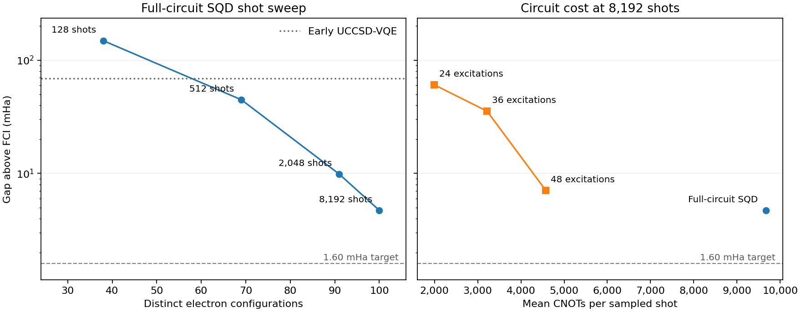

# Sample-Based Quantum Diagonalisation of a Stretched Hydrogen Chain

For the BasQ Qiskit Fall Fest 2026 advanced challenge, I extended Benjamin Tirado’s hydrogen-molecule VQE tutorial to a linear chain of six hydrogen atoms. I sampled electron configurations from simulated quantum circuits and used a classical eigensolver to estimate the ground-state energy within the sampled space. I compared the result with early and converged UCCSD-VQE, two classical configuration-selection controls, and shallower sampling circuits.

**[Open the annotated notebook](h6_sqd.ipynb)**



## Results

The benchmark uses linear H₆ with 1.50 Å between neighbours in the STO-3G basis. The singlet full configuration interaction (FCI) energy is the reference within that model. Smaller gaps are better.

| Method | Gap above singlet FCI (mHa) |
| --- | ---: |
| UCCSD-VQE after one optimiser iteration | 69.25 |
| Full-circuit SQD, 8,192 shots and 100 determinants | **4.72** |
| Converged UCCSD-VQE, 12 optimiser iterations | 4.74 |
| SQD with 48 MP2-ranked excitations, 8,192 shots | 7.07 |
| Uniform random selection, median of 32 trials | 785.59 |
| Hamiltonian-guided selection, matched determinant count | 8.12 |
| Hamiltonian-guided selection, matched singlet dimension | 8.21 |

Full-circuit SQD improved substantially on the early UCCSD-VQE checkpoint and essentially matched converged UCCSD-VQE. The 48-excitation sampler used 4,576 CNOTs per shot, about 53% fewer than the full circuit’s 9,672, with a larger energy gap. The full SQD run reused the early VQE checkpoint. The smaller sampler used angles estimated by second-order Møller–Plesset perturbation theory (MP2).

The runs use noiseless statevector simulation at one geometry. The best H₆ estimate remained above the 1.60 mHa chemical-accuracy target. The gate counts describe compiled circuits and the comparison uses a fixed shot budget for the sampling circuits.

## Run the notebook

The recorded environment used Python 3.14.0. From the repository directory, with Python 3.14 available, run:

```bash
python3.14 -m venv .venv
source .venv/bin/activate
python -m pip install -r requirements.txt
```

Open `h6_sqd.ipynb` in VS Code, select the `.venv` notebook kernel, and run from the imports onward. The original starter install cell can be skipped because `requirements.txt` handles those imports. The notebook uses Qiskit’s statevector tools, so it can run without an IBM Quantum account.

On Apple silicon, PySCF 2.15.1 may need a local build. See the [PySCF installation guide](https://pyscf.org/user/install.html) if installing the pinned version fails.

## Credits and licensing

Benjamin Tirado wrote *Ground-State Energy of a Molecule with VQE* for the BasQ Qiskit Fall Fest 2026. The event was organised by Basque Quantum in collaboration with IBM. Datrim Wadhawan extended the starter notebook with the H₆ SQD benchmark, comparisons and annotations. The original credit and copyright notice are retained in the notebook. [BasQ event recap](https://www.basquequantum.eus/en/news/qiskit-fall-fest-2026-brings-together-quantum-community-three-basque-cities)

The original starter code is licensed under [Apache 2.0](LICENSES/Apache-2.0.txt). The starter text and figures are licensed under [CC BY 4.0](https://creativecommons.org/licenses/by/4.0/).
